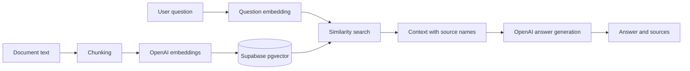

# Architecture

This project is an educational prototype, not a production service.
For production: enforce authentication and per-tenant document isolation; add
upload/format checks, prompt-injection defenses, input limits, observability,
rate limits, retries, transactional upsert, permissions, and careful data retention.
